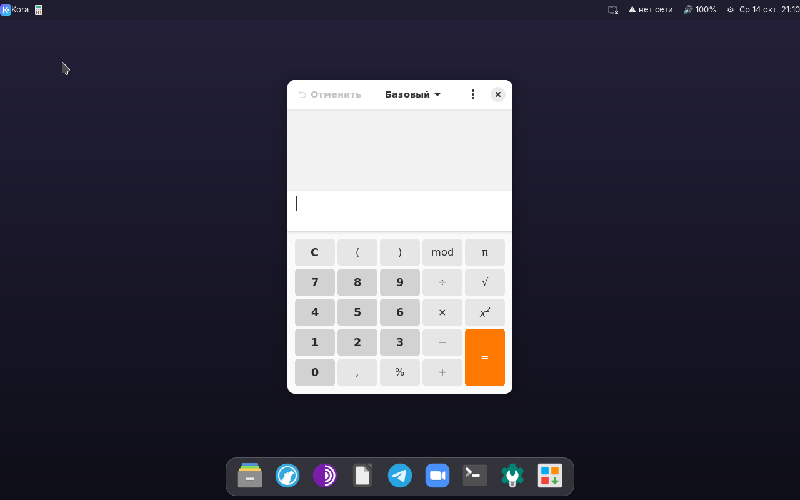

<h1 align="center">Kora OS</h1>

Лёгкая операционная система на Linux с интерфейсом в духе macOS — для слабых компьютеров. 
A lightweight Linux-based OS with a macOS-inspired interface — built for low-end computers.

<a href="../../releases/latest"><b>⬇ Скачать / Download</b></a> ·
<a href="#-русский">Русский</a> ·
<a href="#-english">English</a>

---

## 🇷🇺 Русский

### Что это
Kora OS — система на основе Ubuntu 24.04 с собственной оболочкой: верхняя строка меню, док с иконками, поиск приложений по Win+Пробел и единый фирменный стиль. Цель — быстрая и красивая система, которая работает от 2 ГБ памяти и без мощной видеокарты.

### Что внутри (версия 0.3.1)
**Интерфейс**
- Верхняя строка: сеть, звук, яркость, батарея, часы, меню настроек ⚙.
- Док с иконками, который подсвечивается при наведении.
- 6 тем оформления: Ночь, День, Океан, Лес, Закат, Графит. С темой меняются панели, заголовки окон, терминал и обои.
- Тема программ Materia, иконки Papirus, курсор Breeze, сглаживание шрифтов.
- Экран входа с логотипом.

**Повседневное**
- Wi-Fi: список сетей и ввод пароля по клику на значок сети.
- Ползунки яркости и громкости, клавиши яркости и громкости на ноутбуке.
- Ночной режим — тёплый экран с 20:00 до 7:00.
- Экран блокировки, скриншоты, прилипание окон к краям (см. «Горячие клавиши»).

**Программы**
- Файлы, LibreOffice, Tor Browser, терминал.
- Просмотр PDF и фото, видеоплеер с аппаратным ускорением, калькулятор, архиватор.
- LibreWolf, Telegram и Zoom устанавливаются при первом нажатии в доке (нужен интернет).

**Система**
- Ядро Linux 7.0, сжатие памяти zram, быстрая загрузка.
- Драйверы Wi-Fi, Bluetooth и графики для Intel, AMD, Realtek, Qualcomm, MediaTek, Broadcom.
- Русский язык по умолчанию, раскладка EN/RU переключается Alt+Shift.
- Установщик на диск на русском (Calamares).
- Загрузка с флешки на компьютерах с UEFI и BIOS.

### Горячие клавиши
| Клавиши | Действие |
|---|---|
| Win + Пробел | Поиск и запуск приложений |
| Win + Enter | Терминал |
| Win + L | Заблокировать экран |
| Win + ← / → | Окно на левую / правую половину экрана |
| Win + ↑ / ↓ | Развернуть / свернуть окно |
| Win + Q | Закрыть окно |
| Print / Shift + Print | Скриншот экрана / области |
| Alt + Shift | Сменить раскладку EN/RU |

### Скачать
В разделе **[Releases](../../releases/latest)**: файл `kora-os-0.3.1.iso` и его контрольная сумма `.sha256`.

### Запуск с флешки
1. Запишите образ на флешку от 4 ГБ.
   - **Windows — Rufus:** выберите ISO, нажмите «СТАРТ» и обязательно выберите режим **«DD-образ»**.
   - **macOS / Linux:** balenaEtcher или `dd`.
   - После записи Windows покажет флешку как несколько дисков — это нормально. Не форматируйте их.
2. Загрузитесь с флешки: при включении нажмите клавишу меню загрузки (F12, F9, F11 или Esc — зависит от производителя). Если флешки нет в списке — отключите Secure Boot в BIOS.
3. Выберите «Kora OS». Через 1–2 минуты откроется рабочий стол. Система работает с флешки и ничего не меняет на диске.
4. Чтобы установить на диск, нажмите кнопку установки — последнюю в доке.

Вход в живую систему автоматический. Если система спросит пароль — нажмите Enter или введите `kora`.

### Если что-то не работает
- **Чёрный экран после выбора пункта меню** — выберите «Kora OS (безопасная графика)».
- **«Unable to find a medium containing a live file system»** — проверьте, что флешка записана в режиме DD, или выберите «Kora OS (автопоиск носителя)».
- **Не видно сетей Wi-Fi** — подключите интернет по кабелю или раздайте его с телефона по USB, затем откройте issue с моделью ноутбука.

### Проверено на
- Виртуальные машины QEMU — UEFI и BIOS, загрузка с USB и DVD.
- HP EliteBook 820 G2 — загрузка с флешки.

### Системные требования
- Процессор x86-64 (Intel/AMD). Mac на Apple M1–M4 и ARM-устройства пока не поддерживаются.
- 2 ГБ ОЗУ (рекомендуется 4 ГБ), 16 ГБ на диске для установки.

### Известные ограничения
- Нет анимаций окон и индикатора раскладки в верхней строке.
- Некоторые программы GNOME (например, калькулятор) остаются светлыми в тёмной теме.
- Установка на диск проверена ограниченно.

### Сборка из исходников
Скрипты лежат в папке [`build/`](build) и запускаются по порядку: `build-iso.sh` → `brand.sh` → `improve.sh` → `v03.sh` → `v031.sh` → `v032.sh` → `v033.sh` → `v034.sh`. Загрузочный образ собирает `mkiso.sh`. Нужен Ubuntu или Debian и права root. Пути в скриптах пока жёстко заданы (`/home/claude/...`) — поправьте их под себя.

### История версий
- **0.3.1** — флешка находится по метке (исправлена загрузка на ноутбуках HP), драйверы Wi-Fi/Bluetooth/графики, 6 тем, ползунки яркости и громкости, удобный Wi-Fi, блокировка, скриншоты, ночной режим, новые программы, оформление окон.
- **0.3** — ядро 7.0, экран входа, иконки в доке, светлая тема, LibreWolf.
- **0.2** — установщик, меню настроек, быстрая загрузка, русский язык, логотип.
- **0.1** — первый прототип.

### Планы
Kora Code (редактор кода с ИИ), строка намерений, локальный ИИ-помощник, поиск по смыслу, режим приватности, голосовой ввод, сборка под ARM.

---

## 🇬🇧 English

### What it is
Kora OS is an Ubuntu 24.04–based system with its own shell: a top menu bar, an icon dock, an app launcher on Super+Space, and a consistent visual identity. The goal is a fast, good-looking system that runs on 2 GB of RAM without a dedicated GPU.

### What's inside (version 0.3.1)
**Interface**
- Top bar: network, sound, brightness, battery, clock, ⚙ settings menu.
- Icon dock that highlights on hover.
- 6 themes: Night, Day, Ocean, Forest, Sunset, Graphite. A theme recolors the panels, window titlebars, terminal and wallpaper.
- Materia app theme, Papirus icons, Breeze cursor, tuned font rendering.
- Login screen with the Kora logo.

**Everyday use**
- Wi-Fi: network list and password prompt from the network icon.
- Brightness and volume sliders, laptop brightness and volume keys.
- Night light — warm screen from 20:00 to 07:00.
- Lock screen, screenshots, window snapping (see Keyboard shortcuts).

**Apps**
- Files, LibreOffice, Tor Browser, terminal.
- PDF and image viewers, video player with hardware decoding, calculator, archive manager.
- LibreWolf, Telegram and Zoom install on first click in the dock (internet required).

**System**
- Linux kernel 7.0, zram memory compression, fast boot.
- Wi-Fi, Bluetooth and GPU firmware for Intel, AMD, Realtek, Qualcomm, MediaTek, Broadcom.
- Russian by default; switch the EN/RU layout with Alt+Shift. The installer can change language and time zone.
- Disk installer (Calamares).
- Boots from USB on both UEFI and legacy BIOS machines.

### Keyboard shortcuts
| Keys | Action |
|---|---|
| Super + Space | Search and launch apps |
| Super + Enter | Terminal |
| Super + L | Lock screen |
| Super + ← / → | Snap window to left / right half |
| Super + ↑ / ↓ | Maximize / minimize window |
| Super + Q | Close window |
| Print / Shift + Print | Screenshot of screen / area |
| Alt + Shift | Switch EN/RU layout |

### Download
From **[Releases](../../releases/latest)**: `kora-os-0.3.1.iso` plus its `.sha256` checksum.

### Running from USB
1. Write the image to a USB stick (4 GB+).
   - **Windows — Rufus:** pick the ISO, press START and choose **"DD Image" mode**.
   - **macOS / Linux:** balenaEtcher or `dd`.
   - After writing, Windows shows the stick as several drives — that's expected. Don't format them.
2. Boot from the stick using your boot menu key (F12, F9, F11 or Esc depending on the vendor). If the stick isn't listed, disable Secure Boot in the BIOS.
3. Choose "Kora OS". The desktop appears in 1–2 minutes. The live system runs from the stick and doesn't touch your disk.
4. To install to disk, press the install button — the last one in the dock.

The live session logs in automatically. If you're asked for a password, press Enter or type `kora`.

### Troubleshooting
- **Black screen after choosing a menu entry** — use "Kora OS (safe graphics)".
- **"Unable to find a medium containing a live file system"** — make sure the stick was written in DD mode, or use "Kora OS (auto-detect media)".
- **No Wi-Fi networks listed** — connect via Ethernet or USB tethering from a phone, then open an issue with your laptop model.

### Tested on
- QEMU virtual machines — UEFI and BIOS, USB and DVD boot.
- HP EliteBook 820 G2 — USB boot.

### Requirements
- x86-64 CPU (Intel/AMD). Apple Silicon Macs and ARM devices are not supported yet.
- 2 GB RAM (4 GB recommended), 16 GB disk for installation.

### Known limitations
- No window animations or keyboard-layout indicator in the top bar.
- Some GNOME apps (e.g. the calculator) stay light in dark themes.
- Disk installation has had limited testing.

### Building from source
Scripts live in [`build/`](build) and run in order: `build-iso.sh` → `brand.sh` → `improve.sh` → `v03.sh` → `v031.sh` → `v032.sh` → `v033.sh` → `v034.sh`. `mkiso.sh` builds the bootable image. Requires Ubuntu or Debian and root. Paths are currently hard-coded (`/home/claude/...`) — adjust them for your machine.

### Changelog
- **0.3.1** — USB stick found by label (fixes booting on HP laptops), Wi-Fi/Bluetooth/GPU firmware, 6 themes, brightness and volume sliders, easy Wi-Fi, lock screen, screenshots, night light, new apps, themed windows.
- **0.3** — kernel 7.0, login screen, dock icons, light theme, LibreWolf.
- **0.2** — installer, settings menu, fast boot, Russian language, logo.
- **0.1** — first prototype.

### Roadmap
Kora Code (AI code editor), intent bar, on-device AI assistant, semantic search, privacy mode, offline voice input, ARM builds.
