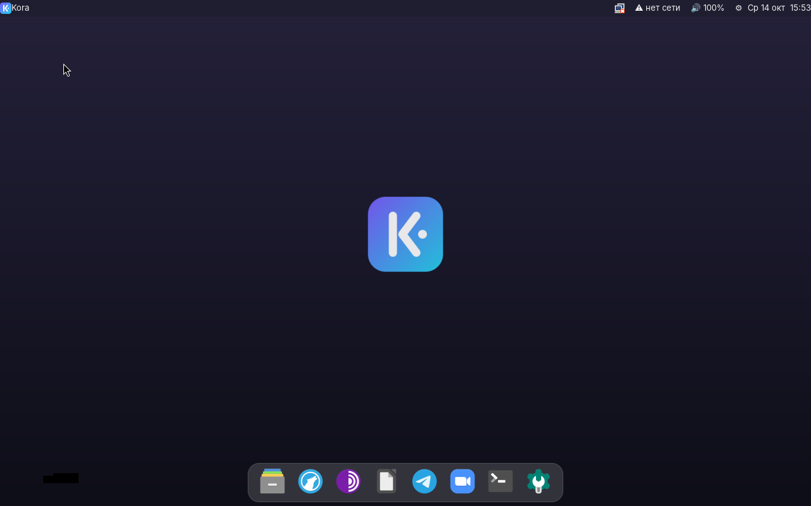
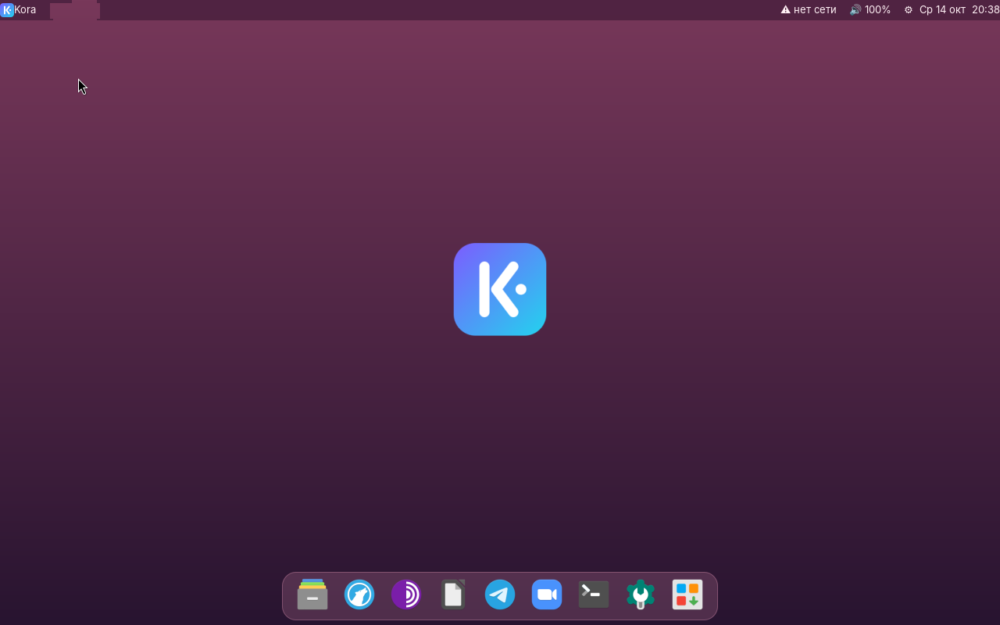
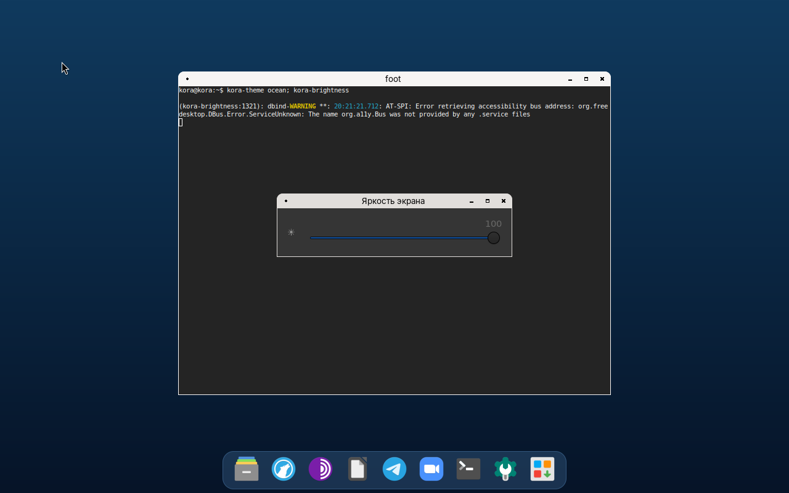

<h1 align="center">Kora OS</h1>

Лёгкая операционная система на Linux с интерфейсом в духе macOS — для слабых компьютеров. 
A lightweight Linux-based OS with a macOS-inspired interface — built for low-end computers.

<b><a href="#-русский">Русский</a> · <a href="#-english">English</a></b>

 

---

## 🇷🇺 Русский

### Что это
Kora OS — сборка на основе Ubuntu 24.04 с собственной оболочкой: верхняя строка меню, док с иконками, поиск приложений по Win+Пробел, единый фирменный стиль. Цель — быстрая и красивая система, которая работает от 2 ГБ памяти и без мощной видеокарты.

### Возможности (версия 0.3.1)
- **Интерфейс:** верхняя строка (сеть, звук, яркость, батарея, часы), док с увеличением иконок при наведении.
- **6 тем оформления:** Ночь, День, Океан, Лес, Закат, Графит — меню ⚙ → «Темы оформления».
- **Яркость экрана:** ползунок (⚙ или клик по ☀), клавиши яркости и громкости на ноутбуке.
- **Драйверы Wi-Fi / Bluetooth / графики** для Intel, Realtek, Qualcomm, MediaTek, Broadcom, AMD.
- **Экран входа** с логотипом и паролем (LightDM).
- **Приложения:** файлы, LibreOffice, Tor Browser, терминал. LibreWolf, Telegram и Zoom устанавливаются при первом запуске из дока.
- **Русский язык** по умолчанию, раскладка EN/RU — Alt+Shift, московское время.
- **Меню настроек** (⚙): Wi-Fi, звук, экран, Bluetooth, яркость, обои, тема, выключение.
- **Установщик на диск** (Calamares) на русском — кнопка установки в доке.
- **Ядро Linux 7.0**, сжатие памяти zram, быстрая загрузка.
- Загрузка с флешки на компьютерах с **UEFI и BIOS**.

### Скачать
Образ — в разделе **[Releases](../../releases/latest)**: файл `kora-os-0.3.1.iso` и контрольная сумма `.sha256`.

### Запуск с флешки
1. Запишите образ на флешку от 4 ГБ: **Rufus** (Windows) — выберите ISO, нажмите «СТАРТ» и обязательно режим **«DD-образ»**; **balenaEtcher** или `dd` — на macOS/Linux.
2. Загрузитесь с флешки: клавиша меню загрузки при включении (F12 / F11 / F8 / Esc). Если не запускается — отключите Secure Boot.
3. Через 1–2 минуты откроется рабочий стол. Если не грузится — в меню выберите «Kora OS (безопасная графика)». Система работает с флешки и ничего не меняет на диске.
4. Чтобы установить на диск — нажмите кнопку установки в доке.

Пользователь живой системы: `kora`, пароль `kora`.

### Системные требования
- Процессор x86-64 (Intel/AMD). Mac на Apple M1–M4 и ARM-устройства пока не поддерживаются.
- 2 ГБ ОЗУ (рекомендуется 4 ГБ), 16 ГБ на диске для установки.

### Сборка из исходников
Скрипты в папке [`build/`](build): `build-iso.sh` → `brand.sh` → `improve.sh` → `v03.sh` → `v031.sh` → `v032.sh` (`mkiso.sh` — сборка загрузочного образа). Нужен Ubuntu/Debian с правами root. Пути в скриптах пока жёстко заданы (`/home/claude/...`) — поправьте под себя.

### Статус
Ранний прототип. Известные ограничения: нет анимаций окон и индикатора раскладки в верхней строке; установка на диск проверена ограниченно.

### Планы
Kora Code (редактор кода с ИИ), строка намерений, локальный ИИ-помощник, поиск по смыслу, режим приватности, голосовой ввод, сборка под ARM.

---

## 🇬🇧 English

### What it is
Kora OS is an Ubuntu 24.04–based distribution with its own shell: a top menu bar, an icon dock, an app launcher on Super+Space, and a consistent visual identity. The goal is a fast, good-looking system that runs on 2 GB of RAM without a dedicated GPU.

### Features (version 0.3.1)
- **Interface:** top bar (network, sound, brightness, battery, clock), dock with hover magnification.
- **6 themes:** Night, Day, Ocean, Forest, Sunset, Graphite — ⚙ menu → Themes.
- **Screen brightness** slider (⚙ or click ☀), laptop brightness and volume keys.
- **Wi-Fi / Bluetooth / GPU firmware** for Intel, Realtek, Qualcomm, MediaTek, Broadcom, AMD.
- **Login screen** with logo and password (LightDM).
- **Apps:** file manager, LibreOffice, Tor Browser, terminal. LibreWolf, Telegram and Zoom install on first launch from the dock.
- **Russian by default**; EN/RU layout switch with Alt+Shift; Moscow time zone (changeable in the installer).
- **Settings menu** (⚙): Wi-Fi, sound, display, Bluetooth, brightness, wallpaper, theme, power.
- **Disk installer** (Calamares) — install button in the dock.
- **Linux kernel 7.0**, zram memory compression, fast boot.
- Boots from USB on both **UEFI and legacy BIOS** machines.

### Download
Get the image from **[Releases](../../releases/latest)**: `kora-os-0.3.1.iso` plus its `.sha256` checksum.

### Running from USB
1. Write the image to a USB stick (4 GB+): **Rufus** on Windows — pick the ISO, press START and choose **"DD Image" mode**; **balenaEtcher** or `dd` on macOS/Linux.
2. Boot from the stick using your boot menu key (F12 / F11 / F8 / Esc). If it won't start, disable Secure Boot.
3. The desktop appears in 1–2 minutes. If it doesn't, choose "Kora OS (safe graphics)" in the boot menu. The live system runs from the stick and doesn't touch your disk.
4. To install to disk, press the install button in the dock.

Live user: `kora`, password `kora`.

### Requirements
- x86-64 CPU (Intel/AMD). Apple Silicon Macs and ARM devices are not supported yet.
- 2 GB RAM (4 GB recommended), 16 GB disk for installation.

### Building from source
Scripts are in [`build/`](build): `build-iso.sh` → `brand.sh` → `improve.sh` → `v03.sh` → `v031.sh` → `v032.sh` (`mkiso.sh` builds the bootable hybrid image). Requires Ubuntu/Debian and root. Paths are currently hard-coded (`/home/claude/...`) — adjust them for your machine.

### Status
Early prototype. Known limitations: no window animations or keyboard-layout indicator in the top bar yet; disk installation has had limited testing.

### Roadmap
Kora Code (AI code editor), intent bar, on-device AI assistant, semantic search, privacy mode, offline voice input, ARM builds.
